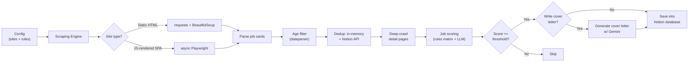

# Automated Job Pipeline

**Config-driven job discovery and AI-assisted application pipeline.**
Scrape job postings across multiple platforms, filter them with a rule-based scoring engine, and generate tailored cover letters with LLMs — all from declarative JSON configuration.

[](https://www.python.org/)
[](#docker)
[](#api)
[](#running-tests)
[](LICENSE)

---

## Why this exists

Job hunting is repetitive: visit the same boards daily, read every posting, discard 90% of them, and rewrite the same cover letter over and over. This pipeline automates the entire loop:

1. **Discover** — crawls multiple job boards per run.
2. **Filter** — rejects old or already-seen postings, then scores the rest against a configurable criteria matrix.
3. **Decide** — only postings above a score threshold move forward.
4. **Apply** — generates a tailored cover letter per surviving posting, cross-referencing the job description with the candidate's resume and portfolio.

The whole system is driven by **declarative JSON configuration** — adding a new job board means adding a config block, not writing new code.

---

## Key features

- **Multi-engine scraping**: static sites via `requests` + `BeautifulSoup`, JavaScript-rendered SPAs via async **Playwright** with automated interactions (button clicks, modals, pagination).
- **Deep crawling**: visits each posting's detail page to extract the full description and posting date.
- **Smart filtering**: posting-age cutoff, plus **two-layer deduplication** — in-memory hash set during the run + Notion API check for historical data — before spending resources on deep crawls.
- **Rule-based scoring engine**: a configurable scoring matrix (`config/hiring_rules.example.json`) — weighted criteria, keyword gates, instant-reject lists.
- **AI cover letters**: generated with Google Gemini, grounded in the candidate's resume/portfolio PDFs and a personal template.
- **Resilient LLM integration**: exponential-backoff retries, selective retry on HTTP 429/5xx, and automatic fallback to a backup model.
- **Memory profiling**: tracks Python + Chromium footprint during scraping runs (psutil).
- **CLI + API**: run as a terminal tool (`python -m job_bot run`) or as a REST API (FastAPI) with async job ticketing and score-filtered queries.
- **Cron-friendly**: `run_daily.sh` builds the Docker image and runs the pipeline on a schedule, on Linux and macOS.

---

## Architecture



### Design decisions

| Decision | Rationale |
|---|---|
| Declarative per-site configs | Job boards change layouts constantly; selectors live in JSON so maintenance never touches core code. |
| Two scraping backends | Playwright is heavyweight — only used for SPAs that require JS rendering or interaction. Static sites get the fast path. |
| Two-layer dedup | In-memory set catches duplicates within a run; Notion API catches historical duplicates across runs. |
| Retry only where it pays | LLM calls and Playwright retry with exponential backoff (429/5xx); scraping failures are logged and skipped so one bad page never kills a run. |
| **Local execution over cloud CI** | GitHub Actions and other cloud CI use datacenter IPs that job boards detect and block with CAPTCHAs. This pipeline is designed to run from residential IPs (local machine, home server, or VPN). |

---

## Pre-requisites
This repo requires **Python 3.14+**. 
### Install python on Windows
Run this from cmd
```bash
winget install Python.Python.3
```
### Install python on Mac
Run this from Terminal
```bash
brew install python
```

### Install python on Linux
```bash
sudo apt update
sudo apt install python3 python3-pip -y
```
## Quickstart
Once you have Python installed run this:

```bash
git clone https://github.com/xinoHITO/automated-job-pipeline.git
cd automated-job-pipeline
python -m venv .venv 
.\.venv\Scripts\activate.bat    # On Mac/Linux:  source .venv/bin/activate
pip install -r requirements.txt
playwright install chromium
```

### Environment variables

Now we rename ".env.example" to ".env"

```bash
cp .env.example .env  #On Windows: ren .env.example .env
```

Next don't forget to fill in the values inside .env! Here's a list of what you need to fill:

| Variable | Purpose |
|---|---|
| `NOTION_TOKEN` | Notion integration token (results database) |
| `DATABASE_ID` | Target Notion database ID |
| `DATA_SOURCE_ID` | Notion data source ID |
| `GEMINI_API_KEY` | Optional: Google Gemini API key (cover letters) |
| `DISCORD_WEBHOOK_URL` | Optional: notifications on run completion |
| `CV_FILE` | Path to your resume PDF (default: `data/resume.pdf`) |
| `PORTFOLIO_FILE` | Path to your portfolio PDF (default: `data/portfolio.pdf`) |
| `COVER_LETTER_TEMPLATE` | Cover letter template path (default: `config/coverLetterTemplate.example.txt`) |
| `API_SECRET_TOKEN` | Shared secret for API auth — clients must send it as the `X-API-Key` header on `POST /run` (API mode only) |
| `MAX_CONCURRENT_TICKETS` | Max pipeline runs processed at the same time (default: `2`) (API mode only)|
| `SLEEP_AFTER_RUN` | For cron jobs (through `run_daily.sh`) set to `1` if you want the host to go to sleep after running the pipeline|

> The PDFs in `data/` are **fictional samples** so the project runs out of the box. Point `CV_FILE`/`PORTFOLIO_FILE` at your own documents.

### Run the pipeline

```bash
# CLI — full run with default config
python -m job_bot run

# CLI — with options
python -m job_bot run --max-days 10 --write-cover

# API — start the FastAPI server
python -m job_bot serve
# or: uvicorn api:app --reload
```

---

## API

Interactive docs available at `http://127.0.0.1:8080/docs` (Swagger UI).

Jobs are handled as **tickets**: `POST /run` enqueues work and returns immediately (202); you poll `/status` with the ticket id, then read results from `/jobs`.

`POST /run` is protected by an API key: the client must send the `API_SECRET_TOKEN` value in the **`X-API-Key` HTTP header**. `GET /status` and `GET /jobs` are open (they only accept a ticket id). If `API_SECRET_TOKEN` is not set, the server generates a random one at startup and prints it to the console — set it explicitly in `.env` for anything beyond local testing.

| Method | Endpoint | Description |
|---|---|---|
| `POST` | `/run` | Enqueue a pipeline run (async, returns 202 + ticket id + link to check ticket status) |
| `GET` | `/status?ticket_id=<id>` | Ticket status: `in queue` / `running` / `done` / `failed` |
| `GET` | `/jobs?ticket_id=<id>&min_score=70` | Jobs from a finished ticket, filtered by score |

`POST /run` body (auth via `X-API-Key` header, not in the body):

| Field | Default | Purpose |
|---|---|---|
| `max_days` | `15` | Ignore postings older than N days |
| `write_cover_letters` | `false` | Generate cover letters for jobs that pass screening |
| `profile` | `false` | Run with memory profiling (psutil) |
| `send_notification` | `false` | Send Discord notification when finished |

Example:

```bash
# 1. Enqueue a run (API key goes in the X-API-Key header)
curl -X POST http://127.0.0.1:8080/run \
  -H "Content-Type: application/json" \
  -H "X-API-Key: YOUR_TOKEN" \
  -d '{"max_days": 10, "write_cover_letters": true}'
# → {"id": "<ticket_id>", "status": "in queue", "poll_url": "..."}

# 2. Poll until done
curl "http://127.0.0.1:8080/status?ticket_id=<ticket_id>"

# 3. Get filtered results
curl "http://127.0.0.1:8080/jobs?ticket_id=<ticket_id>&min_score=70"
```

Ticket state persists in a local SQLite database (`tickets.db`), so queued runs survive an API restart.

---

## Docker

```bash
# Build
docker build -t job-pipeline .

# Run CLI mode (default CMD)
docker run --rm --env-file .env job-pipeline

# Run API mode
docker run --rm --env-file .env -p 8080:8080 job-pipeline python -m job_bot serve
```

The Dockerfile uses the official Playwright base image (`mcr.microsoft.com/playwright/python`) with a non-root user for security.

---

## Scheduled runs (cron)

`run_daily.sh` starts Docker if needed, pulls the latest code, rebuilds the image, and runs the pipeline — designed to be called from cron on a Linux or macOS machine:

```bash
crontab -e
# Run every day at 9:00
0 9 * * * /path/to/job-pipeline/run_daily.sh >> /path/to/job-pipeline/scraper_logs/cron.log 2>&1
```

Notes:

- Requires a `.env` file in the repo root.
- On Linux, starting the Docker daemon may need passwordless sudo (cron has no TTY). If Docker is already running, that step is skipped.
- Set `SLEEP_AFTER_RUN=1` to put the machine to sleep after the run (e.g. waking a Mac just for the scrape).

---

## Configuration

Default config paths point at the shipped `*.example.json` files so the project runs immediately. For real use, create your own copies and pass them explicitly:

```bash
python -m job_bot run \
  --scraping-rules config/my_scraping_rules.json \
  --hiring-rules config/my_hiring_rules.json
```

### Adding a new job board

Each site is one entry in the scraping rules file. No Python required:

```json
{
  "site_name": "https://example-jobs.com",
  "starting_url": "https://example-jobs.com/engineering?remote=true",
  "use_playwright": false,
  "job_item": ".job-card",
  "job_url": ".job-card a.title",
  "job_title": ".job-card a.title",
  "job_company": ".job-card .company",
  "job_location": ".job-card .location",
  "job_description": ".job-description",
  "is_date_in_detail": true,
  "job_post_date": ".posted-date",
  "job_post_date_prefix": "Posted on ",
  "pagination": "a.next",
  "max_page": 5,
  "jobs_cap": -1
}
```

| Field | What it does |
|---|---|
| `use_playwright` | `true` for JS-rendered sites (uses headless Chromium); `false` for static HTML. |
| `job_item` | CSS selector for the job card container. |
| `job_url` / `job_title` / `job_company` / `job_location` | Selectors for each field inside a card. |
| `job_description` | Selector on the **detail page** for the full description. |
| `is_date_in_detail` | Whether the posting date lives on the card or the detail page. |
| `job_post_date_prefix` / `suffix` | Fixed text stripped before date parsing (e.g. `"On board since "`). |
| `pagination` | Selector for the "next page" control. |
| `max_page` / `jobs_cap` | Safety limits (`-1` = unlimited). |

#### Playwright-only extras

```json
"use_playwright": true,
"layer_to_wait_for": ".jobs-loaded",
"click_each_job": true,
"clicks_per_job_before_parsing": [
  { "description": "Read more", "target": ".read-more", "optional": true },
  { "description": "Close modal", "position": { "x": 0, "y": 0 } }
]
```

### Scoring matrix

`config/hiring_rules.example.json` defines the evaluation matrix: score threshold, title gate (target / medium / instant-reject keywords), tech stack weights, career band, and domain bonuses. Edit the keywords and points to match your profile.

---

## Project structure

```
├── config/
│   ├── scraping_rules.example.json   # per-site scraping configs
│   ├── ai_filter_rules.example.json  # scoring matrix
│   ├── hiring_rules.example.json     # keyword hiring rules
│   └── coverLetterTemplate.example.txt
├── data/
│   ├── resume.pdf                    # fictional sample — replace with yours
│   └── portfolio.pdf                 # fictional sample — replace with yours
├── job_bot/
│   ├── __main__.py            # python -m job_bot entrypoint
│   ├── cli.py                 # typer CLI (run / serve)
│   ├── JobBot.py              # pipeline orchestrator
│   ├── webscraper.py          # scraping engine (BS4 + Playwright)
│   ├── webscraping_rules.py   # scraping config models
│   ├── coverletterwriter.py   # LLM scoring + cover letters
│   ├── hiring_rules.py        # hiring rules loader
│   ├── notion.py              # Notion integration (dedup + storage)
│   ├── notification.py        # Discord webhook notifications
│   ├── profiler.py            # memory profiling (psutil)
│   ├── debug.py               # logging helpers
│   └── globals.py             # default paths
├── test/
│   ├── test_webscraper.py
│   └── sample_*.json          # sample site configs for tests
├── api.py                     # FastAPI app
├── run_daily.sh               # cron-friendly daily run (Linux/macOS)
├── Dockerfile
├── requirements.txt
└── README.md
```

---

## Tech stack

**Python 3.11+** · **Playwright** (async) · **BeautifulSoup / requests** · **FastAPI / uvicorn** · **typer** · **dateparser** · **google-genai** · **tenacity** (retry/backoff) · **notion-client** · **SQLite** · **psutil** · **python-dotenv** · **colorama**

---

## Running tests

```bash
python -m pytest test/ -v
```

Tests cover date parsing, age filtering, dedup logic, and hiring rules. Tests that hit live websites or external APIs (Notion, Gemini) require network access and valid credentials in `.env`.

---

## Why not cloud CI?

GitHub Actions, GitLab CI, and similar services use **datacenter IP ranges** that job boards detect and block with CAPTCHAs. This pipeline is designed to run from **residential IPs** (your machine, a home server, or a VPN with residential exit nodes). For automation, use:

- **Local cron** + Docker (`run_daily.sh`)
- **A VPS with residential IP** (Mullvad, ProtonVPN, or similar)

---

## Roadmap

- [x] CLI entrypoint (`run` / `--max-days` / `--write-cover`)
- [x] Docker + containerized execution
- [x] FastAPI service with job ticketing (`POST /run`, `GET /status`, `GET /jobs`)
- [x] Two-layer dedup (in-memory + Notion API)
- [x] Memory profiling (psutil)
- [x] pytest coverage for core parsing logic
- [ ] Multi-profile scoring architecture (switch job-search targets via JSON profiles)
- [ ] Use LLM (Gemini or other) to auto-generate the JSON config files based on a CV/Portfolio
- [ ] PostgreSQL persistence layer (replace SQLite)
- [ ] Cloud deployment of API (Railway/Render) with local scraping
- [ ] Expanded pytest coverage (Playwright mocks)

---

## Disclaimer

Built for **personal use**. Scraping targets are configured manually and accessed at low volume; respect each site's Terms of Service and `robots.txt`. Cover letters are AI-assisted drafts — always review before sending.

---

## License

[MIT](LICENSE)
