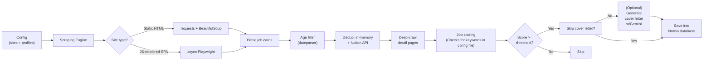

# Job Pipeline

**Config-driven job discovery and AI-assisted application pipeline.**
Scrape hundreds of job postings across multiple platforms, filter them with a rule-based scoring engine, and generate tailored cover letters with LLMs — all from declarative JSON configuration.

[](https://www.python.org/)
[](#docker)
[](#api)
[](#running-tests)
[](LICENSE)

---

## Why this exists

Job hunting is repetitive: visit the same boards daily, read every posting, discard 90% of them, and rewrite the same cover letter over and over. This pipeline automates the entire loop:

1. **Discover** — crawls multiple job boards per run.
2. **Filter** — rejects old or already-seen postings, then scores the rest against a configurable criteria matrix.
3. **Decide** — only postings above a score threshold move forward.
4. **Apply** — generates a tailored cover letter per surviving posting, cross-referencing the job description with the candidate's resume and portfolio.

The whole system is driven by **declarative JSON configuration** — adding a new job board means adding a config block, not writing new code.

---

## Key features

- **Multi-engine scraping**: static sites via `requests` + `BeautifulSoup`, JavaScript-rendered SPAs via async **Playwright** with automated interactions (button clicks, modals, pagination).
- **Deep crawling**: visits each posting's detail page to extract the full description and posting date.
- **Smart filtering**: posting-age cutoff, plus **two-layer deduplication** — in-memory hash set during the run + Notion API check for historical data — before spending resources on deep crawls.
- **Rule-based scoring engine**: a configurable scoring matrix (`config/rules.json`) — weighted criteria, keyword gates, instant-reject lists — evaluated by an LLM for semantic matching.
- **Resilient LLM integration**: exponential-backoff retries, selective retry on HTTP 429/5xx, and automatic fallback to a backup model.
- **AI cover letters**: generated with Google Gemini, grounded in the candidate's resume/portfolio PDFs and a personal template.
- **Memory profiling**: tracks Python + Chromium footprint during scraping runs (psutil).
- **CLI + API**: run as a terminal tool (`python -m job_bot run`) or as a REST API (FastAPI) with async job triggering and score-filtered queries.

---

## Architecture



### Design decisions

| Decision | Rationale |
|---|---|
| Declarative per-site configs | Job boards change layouts constantly; selectors live in JSON so maintenance never touches core code. |
| Two scraping backends | Playwright is heavyweight — only used for SPAs that require JS rendering or interaction. Static sites get the fast path. |
| Two-layer dedup | In-memory set catches duplicates within a run; Notion API catches historical duplicates across runs. |
| Retry only where it pays | LLM calls and Playwright retry with exponential backoff (429/5xx); scraping failures are logged and skipped so one bad page never kills a run. |
| **Local execution over cloud CI** | GitHub Actions and other cloud CI use datacenter IPs that job boards detect and block with CAPTCHAs. This pipeline is designed to run from residential IPs (local machine, home server, or VPN). |

---

## Quickstart

Requires **Python 3.14+**.

```bash
git clone https://github.com/<you>/job-pipeline.git
cd job-pipeline
python -m venv .venv && source .venv/bin/activate   # Windows: .venv\Scripts\activate
pip install -r requirements.txt
playwright install chromium
```

### Environment variables

```bash
cp .env.example .env
```

| Variable | Purpose |
|---|---|
| `NOTION_TOKEN` | Notion integration token (results database) |
| `DATABASE_ID` | Target Notion database ID |
| `DATA_SOURCE_ID` | Notion data source ID |
| `GEMINI_API_KEY` | Google Gemini API key (scoring + cover letters) |
| `DISCORD_WEBHOOK_URL` | Optional: notifications on run completion |

### Run the pipeline

```bash
# CLI — full run with default profile
python -m job_bot run

# CLI — with options
python -m job_bot run --max-days 10 --write-cover

# API — start the FastAPI server
python -m job_bot serve
# or: uvicorn api:app --reload
```

API endpoints (see interactive docs at `http://127.0.0.1:8000/docs`):

| Method | Endpoint | Description |
|---|---|---|
| `POST` | `/run` | Trigger pipeline (async, returns 202) |
| `GET` | `/status` | Pipeline status (running, last result) |
| `GET` | `/jobs?min_score=70` | Last results, filtered by score |

---

## Docker

```bash
# Build
docker build -t job-pipeline .

# Run (with env vars)
docker run --rm --env-file .env job-pipeline

# Run API mode
docker run --rm --env-file .env -p 8000:8000 job-pipeline python -m job_bot serve
```

The Dockerfile uses the official Playwright base image (`mcr.microsoft.com/playwright/python`) with a non-root user for security.

---

## Configuration

### Adding a new job board

Each site is one entry in `config/web_scraping_rules.json`:

```json
{
  "site_name": "https://example-jobs.com",
  "starting_url": "https://example-jobs.com/engineering?remote=true",
  "use_playwright": false,
  "job_item": ".job-card",
  "job_url": ".job-card a.title",
  "job_title": ".job-card a.title",
  "job_company": ".job-card .company",
  "job_location": ".job-card .location",
  "job_description": ".job-description",
  "is_date_in_detail": true,
  "job_post_date": ".posted-date",
  "job_post_date_prefix": "Posted on ",
  "pagination": "a.next",
  "max_page": 5,
  "jobs_cap": -1
}
```

| Field | What it does |
|---|---|
| `use_playwright` | `true` for JS-rendered sites (uses headless Chromium); `false` for static HTML. |
| `job_item` | CSS selector for the job card container. |
| `job_url` / `job_title` / `job_company` / `job_location` | Selectors for each field inside a card. |
| `job_description` | Selector on the **detail page** for the full description. |
| `is_date_in_detail` | Whether the posting date lives on the card or the detail page. |
| `job_post_date_prefix` / `suffix` | Fixed text stripped before date parsing (e.g. `"On board since "`). |
| `pagination` | Selector for the "next page" control. |
| `max_page` / `jobs_cap` | Safety limits (`-1` = unlimited). |

#### Playwright-only extras

```json
"click_each_job": true,
"clicks_per_job": [
  { "description": "Read more", "target": ".read-more", "optional": true },
  { "description": "Close modal", "position": { "x": 0, "y": 0 } }
]
```

---

## Project structure

```
├── config/
│   ├── web_scraping_rules.json
│   └── coverLetterTemplate.txt
├── job_bot/
│   ├── __main__.py            # python -m job_bot entrypoint
│   ├── cli.py                 # typer CLI
│   ├── JobBot.py              # pipeline orchestrator
│   ├── webscraper.py          # scraping engine (BS4 + Playwright)
│   ├── coverletterwriter.py   # LLM scoring + cover letters
│   ├── notion.py              # Notion integration (dedup + storage)
│   ├── profiler.py            # memory profiling (psutil)
│   └── debug.py               # logging helpers
├── test/
│   └── test_webscraper.py
├── api.py                     # FastAPI app
├── Dockerfile
├── requirements.txt
└── README.md
```

---

## Tech stack

**Python 3.14** · **Playwright** (async) · **BeautifulSoup / requests** · **FastAPI / uvicorn** · **typer** · **dateparser** · **google-genai** · **tenacity** (retry/backoff) · **notion-client** · **psutil** · **python-dotenv** · **colorama**

---

## Running tests

```bash
pytest test/ -v
```

Tests cover date parsing, age filtering, and dedup logic. The Notion test requires a valid `NOTION_TOKEN` (skipped otherwise).

---

## Why not cloud CI?

GitHub Actions, GitLab CI, and similar services use **datacenter IP ranges** that job boards detect and block with CAPTCHAs. This pipeline is designed to run from **residential IPs** (your machine, a home server, or a VPN with residential exit nodes). For automation, use:

- **Local cron** + Docker (see `run_daily.sh` for an example with Discord notifications)
- **A VPS with residential IP** (Mullvad, ProtonVPN, or similar)

---

## Roadmap

- [x] CLI entrypoint (`run` / `--profile` / `--max-days` / `--write-cover`)
- [x] Docker + containerized execution
- [x] FastAPI service (`POST /run`, `GET /jobs`, `GET /status`)
- [x] Two-layer dedup (in-memory + Notion API)
- [x] Memory profiling (psutil)
- [x] pytest coverage for core parsing logic
- [ ] Ticketing system to handle FastAPI requests
- [ ] Multi-profile scoring architecture (switch job-search targets via JSON profiles)
- [ ] SQLite/PostgreSQL persistence layer (replace in-memory state)
- [ ] Cloud deployment of API (Railway/Render) with local scraping
- [ ] Scoring matrix presets (more built-in profiles)
- [ ] Expanded pytest coverage (Playwright mocks)


---

## Disclaimer

Built for **personal use**. Scraping targets are configured manually and accessed at low volume; respect each site's Terms of Service and `robots.txt`. Cover letters are AI-assisted drafts — always review before sending.

---

## License

MIT
